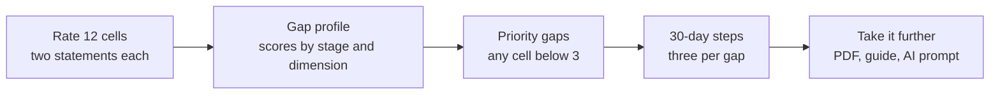

# AIRE Method

**A readiness framework for technology adoption, and a working prototype of its 12-cell diagnostic.**

[Try the prototype](https://aire-method.vercel.app/) · [Facilitation guide (PDF)](https://aire-method.vercel.app/AIRE-Companion-Guide.pdf)

---

## The problem

Most technology adoption decisions skip the most important question: why are we doing this?

They tend to happen among a small group of technical people, which leaves the people who will actually use the tools without a real voice. You shouldn't have to be a technologist to have a valid opinion about the technology that shapes your work.

## The framework

AIRE has four stages. Each one is a phase of the method and a lens in the diagnostic.

| Stage | What it covers |
|---|---|
| **A · Approach** | Observe, diagnose, and evaluate before any tool is chosen. Every later decision traces back here. |
| **I · Implementation** | Analyze the findings, decide, and build with precision. |
| **R · Responsibility** | Accountability at every stage, with documentation that outlives the project. |
| **E · Enablement** | Train the team and hand off clearly. The goal is capacity, not dependency. |

Within each stage, readiness breaks down in one of three ways, called the GAP dimensions: **Goals**, **Actions**, and **Parameters**. Four stages by three dimensions makes a grid of 12 cells, and each cell is a specific question about readiness.

## How the prototype works



1. **Rate.** For each cell, the person reads two statements and rates how true they are today, from 1 (Not Started) to 4 (Established).
2. **See the profile.** Results show an overall score, scores by stage and by dimension, and the full matrix.
3. **Name the gaps.** Any cell scoring below 3 becomes a priority gap, with a name, what it costs the organization, and three steps for the next 30 days.
4. **Take it further.** Results can be saved as a PDF, the facilitation guide can be downloaded, and a ready-made prompt turns the results into a full plan with any AI assistant.

## Decisions

| Decision | What I chose | What I didn't | Why |
|---|---|---|---|
| Where responses live | The browser session only | A database | The prototype proves the experience and the scoring logic first. Nothing is stored, so there's no personal data to protect yet. A production version would store responses so an organization can compare results over time. |
| Saving results | The browser's print dialog, styled as a results sheet | A PDF library | No extra dependency, and every browser can already save as PDF. |
| AI planning | A prompt the person copies into their own assistant | Calling an AI service from the app | No API keys or running costs, the person chooses their own tool, and their results only leave the browser if they decide to share them. |
| The threshold | Below 3 is a priority gap | Ranking every cell | A 3 means "mostly in place." Anything lower is worth a conversation, and the prompt focuses on the top three. |

## Where it came from

AIRE began as a shareable spreadsheet in Google Sheets or Microsoft Excel, paired with a facilitation guide I used with stakeholders across different sectors. I shared it with educators, leaders, and technology stakeholders at the Learning Forward Winter Conference. The app turns that experience into something anyone can move through online, and the facilitation guide stays available as a download.

## Status

A working prototype, not yet tested in the field. A pilot would look at three questions:

- Do people outside technical roles complete the diagnostic and join the conversation about the results?
- Do teams act on the 30-day steps?
- When an organization takes the diagnostic again, have its priority gaps moved?

## Built with

Next.js 14, React 18, TypeScript, Tailwind CSS, and Framer Motion, hosted on Vercel. The framework, cells, scoring, and prompt live in [`src/lib/assessment.ts`](src/lib/assessment.ts).

```bash
npm install
npm run dev   # http://localhost:3000
```

---

AIRE™ and GAP™ are trademarks. © 2026 Bytes with Don · [LinkedIn](https://www.linkedin.com/company/byteswithdon/) · [GitHub](https://github.com/byteswithdon)
